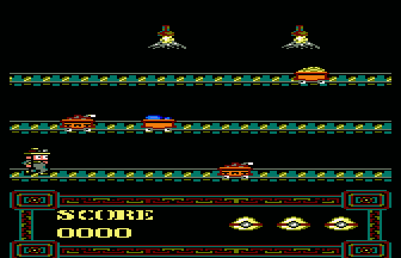

# Rail Runner

An Amstrad CPC game written in Z80 assembly with [CPCtelera](https://github.com/lronaldo/cpctelera). A miner runs along the three rails of a mine: catch the carts full of gold, diamonds and gems, and stay away from the TNT.



Made by Enrique ([HeavenlyDevv](https://github.com/HeavenlyDevv)) and Maxim IJz for [#CPCRetroDev 2023](https://itch.io/jam/cpcretrodev2023). Published on [itch.io](https://amstradartisans.itch.io/rail-runner).

## Play

| File | What it is |
|---|---|
| `dist/railrun.dsk` | Disc image. In an emulator: insert it and type `RUN"RAILRUN` |
| `dist/railrun.sna` | Snapshot. Most emulators start it directly |
| `dist/railrun.cdt` | Tape image |
| `web/index.html` | The game in the browser, with the emulator built in. Open it with a double-click, nothing to install |

| Key | Action |
|---|---|
| Enter | Start |
| I | Instructions |
| O or joystick up | Jump up a rail |
| P or joystick down | Duck down a rail |
| R | Retry the level after a game over |
| Q | Back to the menu |

The full rules are in the [user manual](docs/DEVELOPMENT.md#user-manual).

## Build

You need CPCtelera (`development` branch). The easiest way is the Docker image in `tools/emu`, which keeps all of it out of your system:

```sh
docker build -t railrunner-dev tools/emu          # once, about 10 minutes
docker run --rm -v "$PWD":/work/game railrunner-dev make
```

That produces `railrun.dsk`, `railrun.sna` and `railrun.cdt` in the project folder. With CPCtelera installed, `make` is enough.

The miner, cart and rail graphics are generated from the PNGs in `assets/` by `tools/make_sprites.py` (it writes `src/sprites/masked_sprites.s` and `src/sprites/rails_data.s`): run it after changing those PNGs. CPCtelera converts the other sprites during the build (`cfg/image_conversion.mk`).

## Layout

```
src/
  main.s              screens: menu, levels, game over, win
  man/                entities, game loop, menus, interrupts, struct macros
  sys/                render, background, rails, physics, collisions, animation, spawning, HUD, input
  cpct/               text drawing with the game's own font
  sprites/            generated sprite data
assets/               source PNGs
cfg/                  CPCtelera build configuration
tools/
  make_sprites.py     PNG -> masked sprites and rail patterns
  frames/             text drawings of the miner frames, and frames2png.py
  emu/                test emulator, web player source and Dockerfile
dist/                 the game, ready to play
docs/DEVELOPMENT.md   user manual and how the game was made
web/index.html        the game in the browser
```

## Credits

- Enrique ([HeavenlyDevv](https://github.com/HeavenlyDevv))
- Maxim IJz ([itch.io](https://mi20i.itch.io))
- Engine and tools: [CPCtelera](https://github.com/lronaldo/cpctelera) by ronaldo / Fremos / Cheesetea / ByteRealms (LGPL)
- Emulator used by the web player and the tests: [floooh/chips](https://github.com/floooh/chips) by Andre Weissflog (zlib licence)
