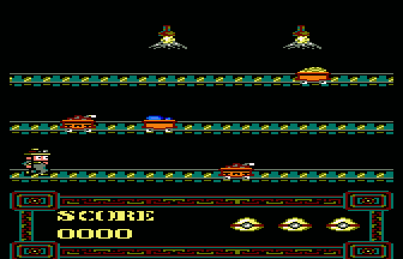
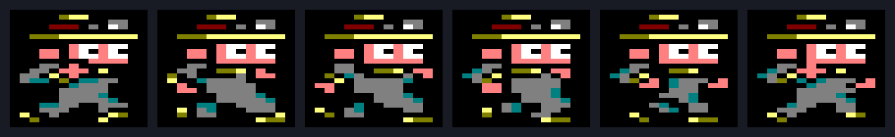
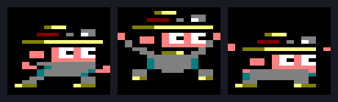
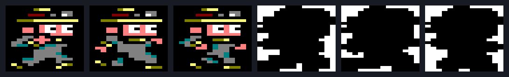
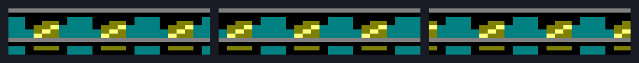
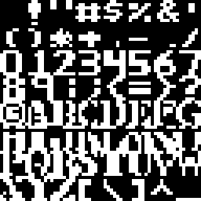

# Rail Runner



- [User manual](#user-manual)
- [How it was made](#how-it-was-made)
  - [Development notes](#development-notes): entities, animations, jumps and ducks, mask, double buffer, drawing only what changes, rails, font, 50 steps per second, memory map
  - [Lessons learned](#lessons-learned)

## User manual

A miner runs along the three rails of a mine. Loaded carts come in from the right, and you choose which rail to be on.

| Cart | When you hit it |
|---|---|
| Gold | +10 points |
| Diamonds | +50 points |
| Gems | +100 points |
| TNT | You lose a heart |

After losing a heart the miner blinks and nothing can hurt him for 4 seconds. Three hits end the game. You clear a level by reaching its points target, and there are 4 levels; each one sends faster carts, more often, and the miner runs and jumps faster to match.

| Key | Action |
|---|---|
| Enter | Start a game |
| I | Show the instructions |
| O or joystick up | Jump up a rail |
| P or joystick down | Duck down a rail |
| R | After a game over, retry the level |
| Q | After a game over, back to the menu |

A tap moves one rail; holding the key keeps the miner moving.

## How it was made

### Development notes

The Amstrad CPC has a 4 MHz Z80 and draws 50 frames a second, so each frame gets 20 ms. The game uses mode 0: 160×200 pixels, 16 colours and two pixels per byte. That is why sprites move one byte (2 pixels) at a time horizontally, but can go on any line vertically.

#### ENTITIES

Everything that moves on screen (the miner, the carts and the lamps) is a 25-byte entity in one array. Each entity has a type made of bits (drawn, moves, collides, animated...), and each system walks the array and works only on the entities with its bits.

So that the fields don't have to be numbered by hand, some macros work out each field's offset:

```asm
BeginStruct indx
SField indx, type,       1      ; bits e_type_*
SField indx, x,          1      ; x in bytes (2 pixels in mode 0)
SField indx, y,          1      ; y in lines
SField indx, vx,         1      ; speed to the left, in 1/256 of a byte per frame
...
EndStruct indx
```

Each field ends up as `indx_x`, `indx_y`... and adding a new field moves the others automatically.

`man_entity_forall_matching` does the walking: it takes the function to apply and the type mask. It can be called from inside itself: collisions walk the carts from the function applied to the miner. When an entity is removed, the last one is copied into its slot, so the array never has gaps.

#### ANIMATIONS

Each entity has a table of frames that it steps through on a frame counter:

```asm
frames_tren_oro::
  .dw #_spr_trenv3_oro_1_m
  .dw #_spr_trenv3_oro_2_m
  .dw #_spr_trenv3_oro_3_m
```

The miner has a 6-frame run cycle:



How fast it cycles depends on the level: every 6 frames on level 1 and every 3 on level 4, so the legs keep pace with the carts.

Carts and lamps only change frame on a frame where they also move, so the animation never costs an extra redraw.

#### JUMPS AND DUCKS

Moving up a rail is a jump and moving down is a duck. Each move is a table with the position and the frame for every step:

```asm
move_up_table:
    .db           0, S_CROUCH       ; push off
    .db           0, S_CROUCH
    .db          -8, S_JUMP
    .db         -16, S_JUMP
    .db         -23, S_JUMP
    ...
```

The jump crouches to push off, rises, goes 3 lines past the rail and drops onto it. Going down, the miner shrinks and falls faster and faster, as if with gravity. Both end with a short crouch on landing.



On the fast levels the table is stepped through quicker (up to 1.75 steps per frame), so the miner can still get out of the way.

#### MASK

The miner and the carts move over the rails, so they can't be drawn as a rectangle: the black around the sprite would cover the rails. So every sprite has a mask.

First the background is ANDed with the mask, which clears (to black) the area where the drawing goes, and then it is ORed with the sprite, which fills that hole:

`screen = (screen AND mask) OR sprite`



All four carts share the same mask:


The mask and the sprite are stored interleaved (one mask byte, one colour byte) so everything happens in one pass. While drawing, the stack points at the sprite, and a single `POP BC` reads the mask and the colour together:

```asm
  .dm_row:
    .rept DM_MAX_W
    pop     bc          ; c = mask, b = colour
    ld      a, (hl)
    and     c
    or      b
    ld      (hl), a
    inc     hl
    .endm
```

That is 11 µs per byte. The loop is unrolled, and drawing jumps in at the point that matches the sprite's width. Since the stack is busy, interrupts are off while it runs.

Carts only ever sit on black or on rails, so instead of reading the background from the screen they read it from the rail data. That way the whole rectangle is rewritten, and when a cart moves only the 1 or 2 byte strip it leaves behind has to be put back.

The masked sprites are generated by `tools/make_sprites.py` from the PNGs of each sprite and its mask. They take twice the space of a plain sprite, but there is no temporary buffer and no extra passes.

#### DOUBLE BUFFER

Masked sprites take time to draw, and if they are drawn on the screen being shown, the beam can catch a sprite half drawn and it flickers. So there is a second screen: drawing happens on the one that isn't shown, and when it's done the two are swapped.

`start_mem` holds the address of the screen being drawn on:

```
0xC0 |    0xC000    |  cpct_pageC0    |  0x30
0x80 |    0x8000    |  cpct_page80    |  0x20
```

And the video memory address is switched:

```asm
switch_buf::
  ld          hl, #start_mem+1
  ld          l, (hl)
  srl         l
  srl         l           ; 0xC0 -> 0x30, 0x80 -> 0x20
  call        cpct_setVideoMemoryPage_asm

  ld          hl, #start_mem+1
  ld          a, #0x40
  xor         (hl)        ; 0x80 <-> 0xC0
  ld          (start_mem+1), a
ret
```

It costs 16 KB of memory, but no sprite is ever seen half drawn.

#### DRAWING ONLY WHAT CHANGES

Redrawing everything every frame doesn't fit in 20 ms, so only what changed is drawn. Each entity remembers what it left drawn on each of the two screens (position and frame). Every frame, on the hidden screen:

1. Whatever changed is erased by putting back the background that was under it.
2. Whatever didn't change but was under something erased is marked for redrawing.
3. Only the marked entities are drawn, the miner last so he is always on top.

The background is black except for the three rail bands, so putting it back means writing black or the right rail row. An entity that stands still costs nothing.

With a lot moving on screen the game draws 18 to 24 times a second, but the logic always runs at 50 steps per second (see below), so the game speed never changes.

#### RAILS

The rails have three animation frames to make them look like they are moving:



Every row of the drawing is a 4-byte pattern repeated across the screen, so only those 4 bytes are stored per row (repeated 4 times, so a copy can start at any position): 528 bytes for all three frames.

They are drawn once when the level starts, and when the frame changes one band is redrawn per frame, first on one screen and then on the other. Only the 7 rows that change are redrawn. Each 80-byte line is filled with `PUSH`, at 2 µs per byte:

```asm
    ld      sp, hl          ; sp = end of the line
    .rept 20
    push    de
    push    bc
    .endm
```

#### FONT

To avoid depending on `cpct_drawStringM0_asm`, which switches on the lower ROM and so needs the code to live above `0x4000`, the game has its own font:



The font sits in RAM at `0x0040` (64 characters of 8 bytes), and the code starts right after it, at `0x0240`. It is drawn by a version of CPCtelera's routine, `_myDrawCharM0_inner` and `_myDrawStringM0`, that reads the characters from there without using the ROM or disabling interrupts.

#### 50 STEPS PER SECOND

Every speed and timer in the game is counted in 50 Hz frames. The game loop draws a frame, waits for the vertical sync, shows it, and runs one logic step for every frame that went by. If a frame takes 40 ms to draw, two logic steps run and the game doesn't slow down. When that happens, the loop stays at 25 frames a second for one second before trying 50 again: a steady rhythm looks smoother than jumping back and forth.

Frames are counted in the interrupt: it fires 6 times per frame, so a frame is counted every 6 interrupts, and when one sees the vertical sync active it is the first of the frame and the count is realigned:

```asm
man_interruption::
  ld    hl, #int_phase
  ld    b, #0xF5            ; PPI port B
  in    a, (c)
  rra                       ; carry = VSYNC active
  jr    nc, .count
  ld    (hl), #1            ; first interrupt of the frame: count now
.count:
  dec   (hl)
  ret   nz
  ld    (hl), #6

  ld    hl, #frame_count
  inc   (hl)
  jp    cpct_scanKeyboard_if_asm
```

Counting only when the vertical sync is seen isn't enough: the pulse is very short, and if it arrives while a sprite is being drawn with interrupts off, it is already over by the time the interrupt runs. Counting in sixes never misses one, because no interrupts-off section lasts longer than the 3.3 ms between interrupts.

To keep movement even, the horizontal position has a fractional part: every frame the speed is added in 1/256 of a byte, and when it goes past 256 the cart moves one byte. Each cart starts with a random fraction so they don't all move on the same frame.

| Level | A cart every | Speed | Points to clear | A lamp every |
|---|---|---|---|---|
| 1 | 0.9 s | 17.6 bytes/s | 20 | 1.6 s |
| 2 | 0.7 s | 26.4 bytes/s | 40 | 1.0 s |
| 3 | 0.46 s | 35.2 bytes/s | 45 | 0.8 s |
| 4 | 0.34 s | 44 bytes/s | 50 | 0.48 s |

The points needed to clear a level count gold as 1, diamonds as 5 and gems as 10; the score on screen shows ten times that.

#### MEMORY MAP

| Address | Contents |
|---|---|
| `0x0000-0x003F` | Z80 vectors (the interrupt at `0x0038`) |
| `0x0040-0x023F` | Font |
| `0x0240-0x54A4` | Code and data (21 KB) |
| `0x54A5-0x7FFF` | Free (about 11 KB) and the stack, growing down from `0x8000` |
| `0x8000-0xBFFF` | Screen 1 |
| `0xC000-0xFFFF` | Screen 2 |

The firmware is switched off at start-up, so all 64 KB belong to the game.

### Lessons learned

On a CPC everything is measured in microseconds: with 20 ms per frame, every byte drawn counts. What makes the biggest difference is not drawing faster but drawing less, and to know what costs what you have to measure it. That is what the emulator in `tools/emu` is for: it reports how long each function takes and checks that what is on screen is what should be there.

The hardware also has its traps: the vertical sync is very short and easy to miss, an `LDIR` with BC at zero copies 64 KB, and an 8-bit register can't hold 1000. And it pays to have every screen of the game return with a `RET` to whoever called it, so the flow between the menu, the levels and the game over is easy to follow and the stack never grows.
